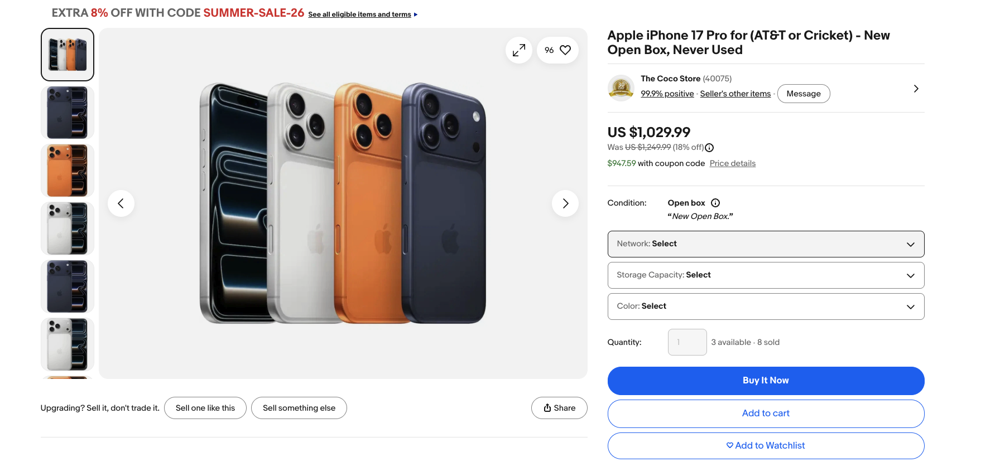
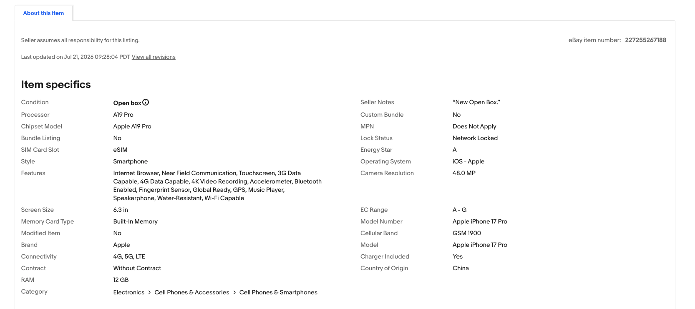
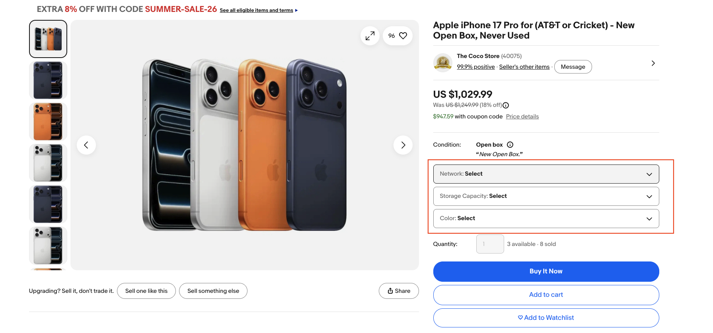

# Core Concepts

Understanding the foundational concepts in the Item domain.

---

## Item, Variation, and Product

### Item

!!! info "Item"
    **Definition:** A listing on eBay's platform. In the data warehouse, `item_id` (also known as `listing_id`) uniquely identifies each item.
    
    **Characteristics:**
    
    - Can be single-SKU (SSKU) or multi-SKU (MSKU)
    - Contains seller-provided metadata (title, price, description, category)
    - Has **attributes** (seller input) and **aspects** (SAP-generated)
    
    **Example:** 
    
    { width="800" }
    
    *"Apple iPhone 17 Pro for (AT&T or Cricket) - New Open Box, Never Used"*
    
    - Item ID: 227255267188
    - Price: $1,029.99
    
    { width="800" }

    - Attributes: Brand=Apple, Condition=Open Box, Processor=A19 Pro, Style=Smartphone, etc

### Variation

!!! info "Variation"
    **Definition:** A specific SKU within a multi-variation listing, reflecting different product configurations.
    
    **Characteristics:**
    
    - Only exists for MSKU items
    - Has **variation traits** (characteristics that differ across SKUs)
    - Each variation has its own price, quantity, SKU
    
    **Example:**
    
    { width="800" }

    For the iPhone listing above, variations might include:
    
    - Variation 1: Network=AT&T, Storage=256GB, Color=Blue
    - Variation 2: Network=T-Mobile, Storage=512GB, Color=Silver
    - Variation 3: Network=Verizon, Storage=1TB, Color=Orange
    
    **Variation Traits:** Network, Storage Capacity, Color

### Product

!!! info "Product"
    **Definition:** Product catalog reference (ePID - eBay Product ID) that groups items representing the same physical entity.
    
    **Types:**
    
    - **Seller-tagged (PROD_REF_ID):** Seller manually assigns ePID during listing creation
    - **Auto-tagged (AT_PROD_REF_ID):** eBay's Structured Data Adoption team assigns ePID
    
    **Relationship:**
    
    - Multiple items (different sellers, conditions, prices) → Same product (ePID)
    - Enables cross-listing analysis and product catalog mapping
    
    **Example:**
    
    ePID 285507661 = "iPhone 15 Pro" → Links all iPhone 15 Pro listings regardless of seller

### Entity Relationships

- One **item** can have 0 to many **variations** (1:N)
- Multiple **items** reference the same **product** via ePID (N:1)

---

## Attributes vs Aspects

Two ways to describe item characteristics. The core difference lies in **data source and quality**:

!!! note "Attribute vs Aspect Comparison"
    | Dimension | **Attribute** | **Aspect** |
    |-----------|---------------|------------|
    | **Data Source** | Seller input | **Processed from attributes** by SAP (Search Annotation Platform) |
    | **Data Quality** | Raw data, inconsistent format | Cleaned, standardized, enriched |
    | **Generation** | Seller provides when creating listing | SAP extracts, normalizes, and standardizes from attributes |
    | **Primary Use** | View Item Page display, basic filtering | Search indexing, recommendations, high-precision classification |
    | **Visibility** | Buyer-facing (shown on product page) | Internal eBay systems (search, recommendation) |
    | **Example** | Brand=apple, Storage=256 GB, Color=dark blue | Brand=Apple, Storage=256GB, Color=Blue, Screen_Size=6.3" |
    | **Storage** | EAV pattern | Structured taxonomy with namespace/classifier IDs |
    | **Tables** | `dw_attr_detail_values`, `dw_attr_lstg_dtl`, `dw_attr_shpmt_dtl` | `item_aspct_clssfctn_sap`, `vrtn_aspct_clssfctn_sap` |
    
    **Why do we need Aspects?**
    
    Seller-provided attributes have inconsistent quality (typos, format variations, missing information), which cannot meet the precision requirements of search and recommendation systems. SAP generates high-quality aspects through:
    
    - **Normalization**: apple → Apple, 256 GB → 256GB (via UNS - Unified Normalization Service)
    - **Enrichment**: Extract missing attributes from title/description (e.g., Screen Size, OS)
    - **Standardization**: Map to unified names/values using UMS (Unified Metadata System)

!!! example "Real-world Example"
    **Seller-provided Attributes:**
    ```
    Brand=apple, Storage=256 GB, Color=dark blue
    ```
    
    **SAP-generated Aspects:**
    ```
    Brand=Apple, Storage=256GB, Color=Blue, 
    Screen_Size=6.3", Operating_System=iOS, Camera_Resolution=48MP
    ```
    
    Notice how aspects are standardized and include additional information extracted from the listing.

---

## Variation Traits

!!! note "Traits"
    **Definition:** Variation-level characteristics that differentiate SKUs within the same multi-SKU item.
    
    **Characteristics:**
    
    - Only exist for MSKU items with variations
    - Describe the specific features that differ across variations
    - Common trait types: Color, Size, Style, Capacity, Network, Material
    
    **Purpose:**
    
    - Enable SKU differentiation within the same listing
    - Support variation-level analysis (e.g., which color/size sells better)
    - Help buyers select the specific variant they want
    
    **Examples:**
    
    For a clothing item with multiple variations:
    
    - **Traits**: Color (Red, Blue, Black), Size (S, M, L, XL)
    - Variation 1: Color=Red, Size=S
    - Variation 2: Color=Blue, Size=M
    - Variation 3: Color=Black, Size=L
    
    For a smartphone listing:
    
    - **Traits**: Network (AT&T, Verizon, Unlocked), Storage (128GB, 256GB, 512GB), Color (Blue, Silver, Gold)
    - Variation 1: Network=AT&T, Storage=256GB, Color=Blue
    - Variation 2: Network=Unlocked, Storage=512GB, Color=Silver

**Key Distinction:**

- **Attributes/Aspects** describe the **item as a whole** (e.g., Brand=Apple applies to all variations)
- **Traits** describe **differences between variations** (e.g., Color=Blue vs Color=Silver)

---

## Summary

| Concept | Level | Definition | Primary Use |
|---------|-------|------------|-------------|
| **Item** | Listing | A listing on eBay (SSKU or MSKU) | Core entity for product analysis |
| **Variation** | SKU | Specific SKU within MSKU item | SKU-level inventory/pricing |
| **Product** | Catalog | eBay Product ID (ePID) grouping | Cross-listing analysis |
| **Attribute** | Item metadata | Seller-provided properties | Product filtering, classification |
| **Aspect** | Item metadata | SAP-processed standardized properties | Search indexing, recommendations |
| **Trait** | Variation metadata | Variation-level differentiators | SKU differentiation |
