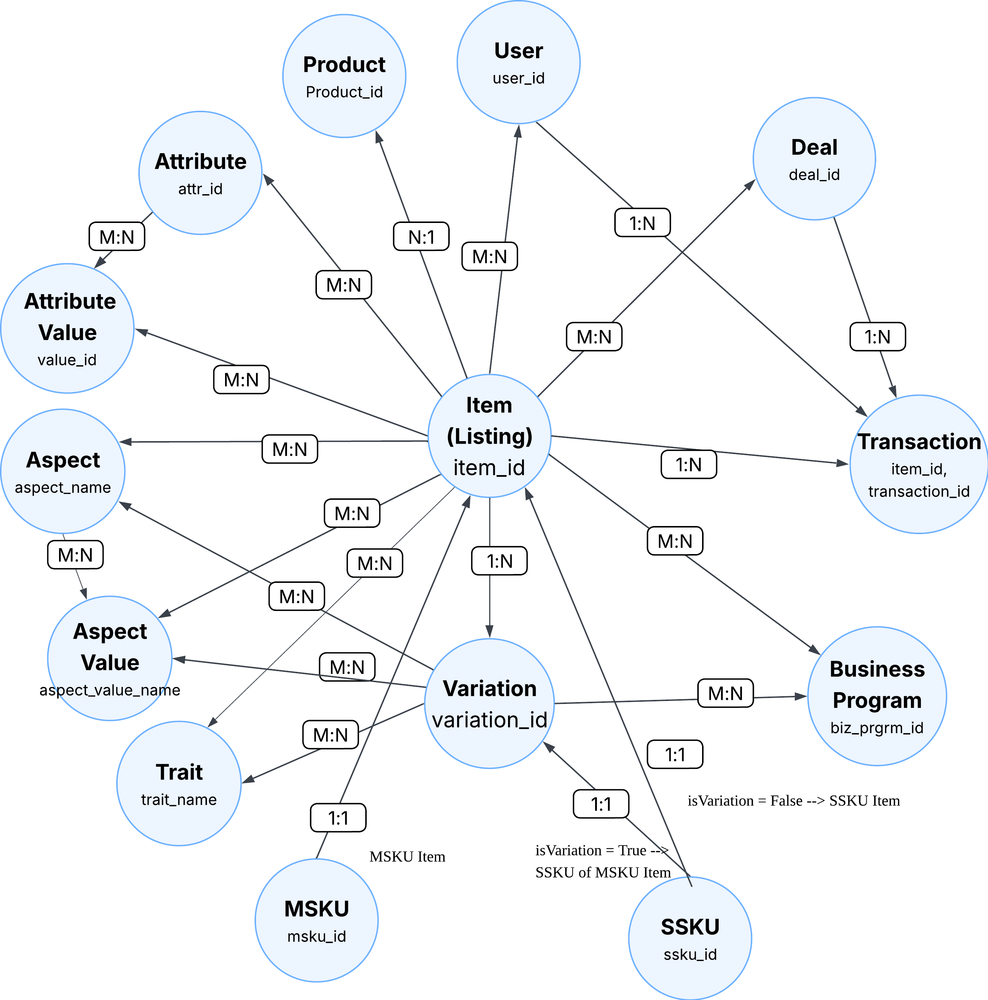

# Item Domain Logical Data Model (LDM)

## Overview

Item LDM is the **standard, governed logical interface** for eBay item-domain data, abstracting fragmented underlying physical sources to enable self-service consumption on GDS platform to support business use cases such as data engineering, analytics, and ML feature engineering.

---

## Core Concepts

Understanding Item domain fundamentals:

<div class="grid cards" markdown>

- :material-cube-outline: **Item, Variation, Product**

    ---
    
    Core entity hierarchy: listings (item), SKUs (variation), and catalog references (product/ePID)

- :material-tag-text-outline: **Attributes vs Aspects**

    ---
    
    Two ways to describe items: seller-provided attributes vs SAP-processed aspects with higher quality

- :material-palette-outline: **Variation Traits**

    ---
    
    SKU-level differentiators like Color, Size, Network that distinguish variations

</div>

[Learn core concepts in detail →](concepts/core-concepts.md)

---

## Item Domain LDM Map

All available LDM entities in the Item domain:




!!! tip "New to Item LDM?"
    Start with **item**, **variation**, and **attribute** entities - they cover most common use cases.

---

## Quick Start

### Access Methods

=== "Spark SQL"
    Query via Spark SQL on DLS:
    
    ```sql
    -- Example: Query active items in a specific category
    SELECT 
        item_id,
        item_title,
        item_price,
        leaf_categ_id,
        seller_id
    FROM gds.item
    WHERE item_site_id = 0
      AND leaf_categ_id = 58058
      AND item_price > 100
    LIMIT 100;
    ```

=== "DDF Python"
    Programmatic access via Declarative Data Flow (DDF): Examples to be added.

### Common Query Scenarios

=== "Basic Item Info"
    **Entity:** `item`
    
    **Use case:** Query title, price, category, seller, etc.
    
    ```sql
    SELECT item_id, item_title, item_price, leaf_categ_id
    FROM gds.item
    WHERE item_site_id = 0
    LIMIT 100;
    ```

=== "Multi-SKU Products"
    **Entity:** `variation`
    
    **Use case:** Different sizes/colors of the same product
    
    ```sql
    SELECT item_id, variation_id, variation_sku, variation_price
    FROM gds.variation
    WHERE item_id = 123456789;
    ```

=== "Item Attributes"
    **Entity:** `attribute` + `attribute_value`
    
    **Use case:** Brand, material, color (EAV pattern)
    
    ```sql
    SELECT i.item_id, i.item_title, m.attr_id, m.value_desc
    FROM gds.item i
    JOIN gds.item_common_attribute_value_mapping m ON i.item_id = m.item_id
    WHERE m.attr_id = 1000;
    ```

=== "Transaction Data"
    **Entity:** `transaction`
    
    **Use case:** Sales analytics, buyer behavior
    
    ```sql
    SELECT item_id, transaction_id, transaction_date, transaction_amount
    FROM gds.transaction
    WHERE transaction_date >= '2024-01-01';
    ```

=== "Promotional Deals"
    **Entity:** `deal`
    
    **Use case:** Items in promotions
    
    ```sql
    SELECT deal_id, item_id, deal_type, discount_pct
    FROM gds.deal
    WHERE deal_status = 'active';
    ```

[See comprehensive query examples →](guides/query-examples.md)

!!! tip "Migrating from Legacy Hive Tables?"
    Currently using `DW_LSTG_ITEM`, `DW_ATTR_DETAIL_VALUES`, or other legacy tables? See the [Migration Guide](guides/migration-guide.md) for step-by-step instructions to migrate your queries to Item Domain LDM.

---

## LDM Catalog

| LDM Name | Description | Primary Key(s) | Details                              |
|----------|-------------|----------------|--------------------------------------|
| **item** | Core listing entity | `item_id` | [Details →](entities/item.md)        |
| **variation** | Multi-SKU variations of a listing | `variation_id` | [Details →](entities/variation.md)   |
| **product** | Product catalog reference (ePID) | `product_id` | [Details →](entities/product.md)     |
| **transaction** | Purchase transactions | `item_id`, `transaction_id` | [Details →](entities/transaction.md) |
| **attribute** | Item attributes (brand, model, color, etc.) | `attribute_id` |                                      |
| **attribute_value** | Attribute values (Nike, Red, etc.) | `attribute_value_id` |                                      |
| **trait** | Variation-level traits (Color, Size, Material) | `trait_name` |                                      |
| **aspect** | SAP-generated classification aspects | `aspect_name`, `namespace_id`, `classifier_id` |                                      |
| **aspect_value** | Aspect value definitions | `aspect_value_name` |                                      |
| **deal** | Promotional deals and offers | `deal_id` |                                      |
| **business_program** | Business programs (Authenticity, Vault, etc.) | `business_program_id` |                                      |
| **msku** | Multi-SKU (Stock Keeping Unit) item | `msku_id` |                                      |
| **ssku** | Single SKU (Stock Keeping Unit) item | `ssku_id` |                                      |

---

## Entity Relationships

| Relationship | Type | Description |
|--------------|------|-------------|
| **Item → Variation** | 1:N | One item has multiple variations (e.g., different sizes/colors) |
| **Item → Product** | N:1 | Multiple items reference the same product catalog |
| **Item ↔ Attribute** | M:N | Items have multiple attributes (brand, model, color, etc.) |
| **Item ↔ Attribute Value** | M:N | Items are associated with specific attribute values (EAV pattern) |
| **Attribute ↔ Attribute Value** | M:N | One attribute can have multiple values |
| **Item ↔ Aspect** | M:N | Items have SAP-generated classification aspects |
| **Aspect ↔ Aspect Value** | M:N | One aspect can have multiple values (similar to Attribute-Value pattern) |
| **Item ↔ Aspect Value** | M:N | Items are associated with specific aspect values |
| **Variation ↔ Aspect** | M:N | Variations have SAP aspects at variation level |
| **Variation ↔ Aspect Value** | M:N | Variations are associated with specific aspect values |
| **Variation ↔ Trait** | M:N | Variations have traits like Color, Size, Material |
| **Item ↔ Trait** | M:N | MSKU Items have traits like Color, Size, Material |
| **Item ↔ Deal** | M:N | Items can participate in multiple deals |
| **Item ↔ Business Program** | M:N | Items are eligible for business programs (Authenticity, Vault, etc.) |
| **Variation ↔ Business Program** | M:N | Variations have program eligibility at variation level |
| **Item → Transaction** | 1:N | One item has multiple purchase transactions |
| **Deal → Transaction** | 1:N | One deal can have multiple transactions |

### How to Query Relationships

**1. For 1:N / N:1 Relationships**

Query from the "many" side entity:

```sql
-- Example: Get variations for an item (1:N)
SELECT 
    v.item_id,
    v.variation_id,
    v.variation_sku,
    v.variation_price
FROM gds.variation v
WHERE v.item_id = 123456789;
```

**2. For M:N Relationships**

**Current Approach** - Pre-joined denormalized mapping tables are modeled as LDM entities for direct consumption:

| Relationship | Mapping LDM Name                           | Primary Keys                                                                                           | Physical Sources         | Details                                                  |
|--------------|--------------------------------------------|--------------------------------------------------------------------------------------------------------|--------------------------|----------------------------------------------------------|
| Item ↔ Attribute Value (Common Attributes) | **item_common_attribute_value_mapping**                  | `item_id`, `attr_id`, `value_id`                                                                       | DW_ATTR_DETAIL_VALUES    | [View Details →](relationships/item_common_attribute_value_mapping.md) |
| Item ↔ Attribute Value (Listing) | **item_listing_attribute_value_mapping**                       | `item_id`, `gcs_id`, `vcs_id`, `lstg_attr_id`, `value_id`, `value_desc`                                | DW_ATTR_LSTG_DTL         |                                                          |
| Item ↔ Attribute Value (Shipment) | **item_shipment_attribute_value_mapping**                 | `item_id`, `gcs_id`, `vcs_id`, `shpmt_attr_id`, `value_id`, `value_desc`                               | DW_ATTR_SHPMT_DTL </br> DW_ATTR_SHPMT_DTL_COLD |                                                          |
| Item ↔ Attribute Value (Fitment) | **item_fitment_attribute_value_mapping**                     | `item_id`, `auct_end_dt`, `ftmnt_grp_id`, `ftmnt_name`, `ftmnt_value_text`, `src_ind`, `cmbntn_grp_id` | DW_LSTG_ITEM_FTMNT       |                                                          |
| Item ↔ Attribute Value (Tags) | **item_tag_attribute_value_mapping**                   | `item_id`, `gcs_id`, `vcs_id`, `lstg_attr_id`, `tag_name`, `tag_value_txt`                             | DW_ATTR_LSTG_TAG_DTL     |                                                          |
| Item ↔ Attribute Value (Tax) | **item_tax_attribute_value_mapping**                          | `item_id`, `sale_tax_rate`, `jrsdctn_cntry_id`, `jrsdctn_tx`                                           | LSTG_SALE_TAX            |                                                          |
| Item ↔ Picture | **item_picture_mapping**                          | `item_id`, `trait_name`                                                                                | LSTG_ITEM_PIC            |                                                          |
| Item ↔ Aspect Value | **item_aspect_value_mapping**                | `item_id`, `aspect_name`, `aspect_value_name`                                                          | ITEM_ASPCT_CLSSFCTN_SAP  |                                                          |
| Variation ↔ Aspect Value | **variation_aspect_value_mapping**                | `variation_id`, `aspect_name`, `aspect_value_name`                                                     | VRTN_ASPCT_CLSSFCTN_SAP  |                                                          |
| Variation ↔ Trait | **variation_trait_mapping**                   | `variation_id`, `trait_name`                                                                           | LSTG_ITEM_VRTN_TRAIT     |                                                          |
| Item ↔ Business Program | **item_business_program_mapping**      | `item_id`, `biz_prgrm_id`                                                                              | DW_PES_ELGBLT_HIST       |                                                          |
| Variation ↔ Business Program | **variation_business_program_mapping** | `item_vrtn_id`, `biz_prgrm_id`                                                                         | DW_PES_ELGBLT_HIST       |                                                          |

```sql
-- Example: Get item attributes using mapping table
SELECT 
    i.item_id,
    i.item_title,
    m.attr_id,
    m.value_desc
FROM gds.item i
JOIN gds.item_common_attribute_value_mapping m ON i.item_id = m.item_id
WHERE i.item_site_id = 0
  AND m.attr_id = 1000
LIMIT 100;
```

**Future Vision** - The long-term vision is to abstract M:N relationships into more intuitive entity-relationship models with dynamic materialization on DDF. Please refer to the [Modeling Strategy](reference/ldm-modeling-principle.md) document for details.

---

## Resources

- [Query examples](guides/query-examples.md)
- [LDM modeling principles](reference/ldm-modeling-principle.md)
- [FAQ](faq.md)
