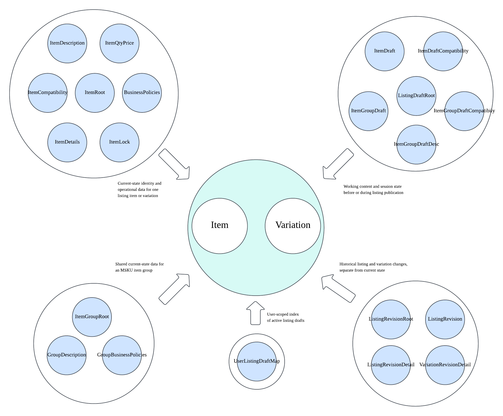

# Item Domain Logical Data Model (LDM)

## Overview

Item LDM is the **standard, governed logical interface** for eBay item-domain data, abstracting fragmented underlying physical sources to enable self-service consumption on GDS platform to support business use cases such as data engineering, analytics, and ML feature engineering.

---

## Core Concepts

Understanding Item domain fundamentals:

<div class="grid cards" markdown>

- :material-cube-outline: **Item, Variation, Product**

    ---
    
    Core entity hierarchy: listings (item), SKUs (variation), and catalog references (product/ePID)

- :material-tag-text-outline: **Attributes vs Aspects**

    ---
    
    Two ways to describe items: seller-provided attributes vs SAP-processed aspects with higher quality

- :material-palette-outline: **Variation Traits**

    ---
    
    SKU-level differentiators like Color, Size, Network that distinguish variations

</div>

[Learn core concepts in detail →](concepts/core-concepts.md)

---

## Item Domain LDM Map

Here're the main LDM entities in the Item domain:



---

## LDM Catalog

| LDM Name | Type | Description | Business Key(s) | Details |
|----------|------|-------------|----------------|---------|
| **item** | Governed entity | Core listing entity representing one eBay listing | `item_id` | [Details →](entities/item.md) |
| **variation** | Governed entity | Multi-SKU variation of a listing | `variation_id` | [Details →](entities/variation.md) |
| **ItemRoot** | Raw NuDocument | Current-state identity and broad listing data for one item or variation | `itemId` | [Details →](entities/itemkeyspace-root.md) |
| **ItemCompatibility** | Raw NuDocument | Item fitment and compatibility payload | `itemId` | [Details →](entities/itemkeyspace-item-compatibility.md) |
| **ItemDescription** | Raw NuDocument | Seller-provided item description and revision data | `itemId` | [Details →](entities/itemkeyspace-item-description.md) |
| **ItemPriceAndQuantity** | Raw NuDocument | Item quantity, inventory, and price state | `itemId` | [Details →](entities/itemkeyspace-item-qty-price.md) |
| **ItemDetails** | Raw NuDocument | Additional item details, high-precision prices, and supporting data | `itemId` | [Details →](entities/itemkeyspace-item-details.md) |
| **ItemBusinessPolicies** | Raw NuDocument | Item-level return, payment, and shipping policy content | `itemId` | [Details →](entities/itemkeyspace-business-policies.md) |
| **ItemUUIDMapping** | Raw NuDocument | Seller and UUID lookup mapping to an item and listing application | `sellerId`, `uuid` | [Details →](entities/itemkeyspace-uuid-map.md) |
| **ItemLock** | Raw NuDocument | Inventory reservation and lock lifecycle state | `itemId`, `lockId` | [Details →](entities/itemkeyspace-item-lock.md) |
| **ItemGroupRoot** | Raw NuDocument | Shared identity and variation data for an MSKU item group | `groupId` | [Details →](entities/itemgroupkeyspace-root.md) |
| **ItemGroupDescription** | Raw NuDocument | Shared description for an MSKU item group | `groupId` | [Details →](entities/itemgroupkeyspace-group-description.md) |
| **ItemGroupBusinessPolicies** | Raw NuDocument | Shared group-level return, payment, and shipping policies | `groupId` | [Details →](entities/itemgroupkeyspace-group-business-policies.md) |
| **ListingDraftRoot** | Raw NuDocument | Listing-draft session state, flags, and variation identifiers | `draftId` | [Details →](entities/listingdraft-root.md) |
| **ListingDraftItem** | Raw NuDocument | Draft content for an SSKU item or MSKU variation | `draftId`, `variationId` | [Details →](entities/listingdraft-item-draft.md) |
| **ListingDraftItemCompatibility** | Raw NuDocument | Optional SSKU compatibility payload for a listing draft | `draftId` | [Details →](entities/listingdraft-item-draft-compatibility.md) |
| **ListingDraftGroup** | Raw NuDocument | Shared MSKU draft-group content and variation traits | `draftId`, `groupId` | [Details →](entities/listingdraft-item-group-draft.md) |
| **ListingDraftGroupCompatibility** | Raw NuDocument | Optional MSKU group-level compatibility payload | `draftId` | [Details →](entities/listingdraft-item-group-draft-compatibility.md) |
| **ListingDraftGroupDescription** | Raw NuDocument | Optional shared MSKU group description and revision data | `draftId` | [Details →](entities/listingdraft-item-group-draft-desc.md) |
| **UserListingDraftMap** | Raw NuDocument | User-scoped index of active listing drafts and summary metadata | `userId`, `draftId` | [Details →](entities/userlistingdraft-user-item-draft-map.md) |
| **ListingRevisionRoot** | Raw NuDocument | Retention state for a listing's revision history | `listingId` | [Details →](entities/listingrevisionkeyspace-root.md) |
| **ListingRevision** | Raw NuDocument | Historical summary of a listing revision and changed property groups | `listingId`, `revisionId` | [Details →](entities/listingrevisionkeyspace-listing-revision.md) |
| **ListingRevisionDetail** | Raw NuDocument | Historical non-variation property-level change record | `listingId`, `revisionId` | [Details →](entities/listingrevisionkeyspace-listing-revision-detail.md) |
| **ListingVariationRevisionDetail** | Raw NuDocument | Historical variation-specific property-level change record | `listingId`, `revisionId`, `variationId` | [Details →](entities/listingrevisionkeyspace-variation-revision-detail.md) |


---

## LDM Relationships and Lifecycle

The catalog contains two LDM types:

- **Governed LDMs** provide the consumer-facing **item** and **variation**
  models.
- **Raw LDMs** represent source data and behavior. They are grouped according
  to the source and site application model design.

The relationships below explain how the raw-LDM groups support the listing
lifecycle, rather than describing relational-table joins.

### Current Listing State

The governed **item** and **variation** entities represent a listing and its
SKU-level variations. Their raw current-state data is held in
**ItemKeyspace**. **ItemRoot** contains the identity and broad state for one
item or variation. **ItemCompatibility**, **ItemDescription**,
**ItemPriceAndQuantity**, **ItemDetails**, and **ItemBusinessPolicies** are
separate raw LDMs, allowing those portions of the listing to be read and
updated independently. **ItemLock** records one or more inventory
reservations for the item. **ItemUUIDMapping** is a seller-and-UUID lookup
that resolves a listing.

### Shared MSKU State

**ItemGroupKeyspace** holds data shared by the variations in an MSKU listing.
**ItemGroupRoot** identifies the group and references its member items, while
**ItemGroupDescription** and **ItemGroupBusinessPolicies** hold the shared
description and policies. The group does not replace the current state of its
member variations: their sellable price, quantity, lifecycle, and other
item-specific data remain in **ItemKeyspace**.

### Draft Listing State

**ListingDraft** is an independent working-state group used before or during
publication. **ListingDraftRoot** stores draft-session state. An SSKU
draft contains **ListingDraftItem** and can include
**ListingDraftItemCompatibility**. An MSKU draft contains
**ListingDraftGroup**, **ListingDraftGroupDescription**, and optionally
**ListingDraftGroupCompatibility**, plus one **ListingDraftItem** for each
variation. Draft LDMs do not imply that a corresponding live
**ItemKeyspace** or **ItemGroupKeyspace** record exists.

### Active Draft Discovery

**UserListingDraftMap** is a user-scoped index of active drafts. It connects a
user and a draft identifier to summary metadata used to find the draft, but
does not contain the full **ListingDraft** content. Its lifecycle is separate
from the draft content: creating, updating, or deleting one does not
automatically change the other.

### Listing Revision History

**ListingRevisionKeyspace** stores historical changes by listing identifier,
separately from current state. **ListingRevisionRoot** is optional retention
state. Each **ListingRevision** records a revision summary and can
have multiple **ListingRevisionDetail** children for listing-property changes
and **ListingVariationRevisionDetail** children for variation-property
changes. These LDMs are history records and do not replace the latest
**ItemKeyspace** or **ItemGroupKeyspace** data.

---

## Quick Start

### Access Methods

=== "Spark SQL"
    Query via Spark SQL on DLS:
    
    ```sql
    -- Example: Query active US listings in a specific category
    SELECT 
        item_id,
        auct_titl             AS title,
        bin_price_lstg_curncy AS price,
        leaf_categ_id,
        slr_id
    FROM gds.item
    WHERE item_site_id = 0
      AND leaf_categ_id = 9355
      AND bin_price_lstg_curncy > 100
    LIMIT 100;
    ```

=== "DDF Python"
    Programmatic access via Declarative Data Flow (DDF): Examples to be added.

!!! tip "Migrating from Legacy Hive Tables?"
    Currently using `DW_LSTG_ITEM`, `DW_ATTR_DETAIL_VALUES`, or other legacy tables? See the [Migration Guide](guides/migration-guide.md) for step-by-step instructions to migrate your queries to Item Domain LDM.

---

## Resources

- [Query examples](guides/query-examples.md)
- [LDM modeling principles](reference/ldm-modeling-principle.md)
- [FAQ](faq.md)
