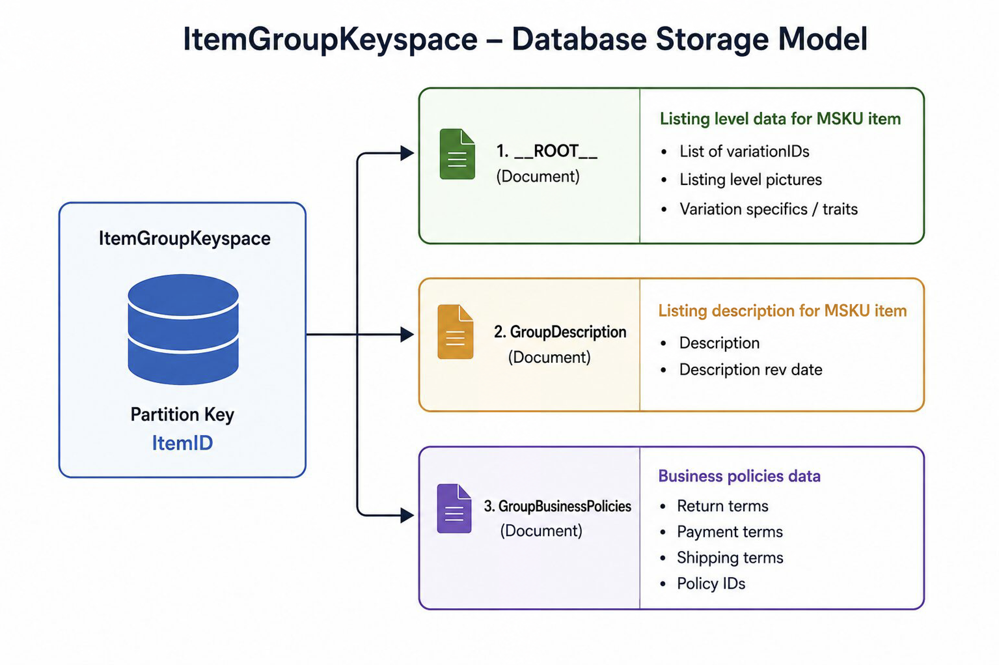
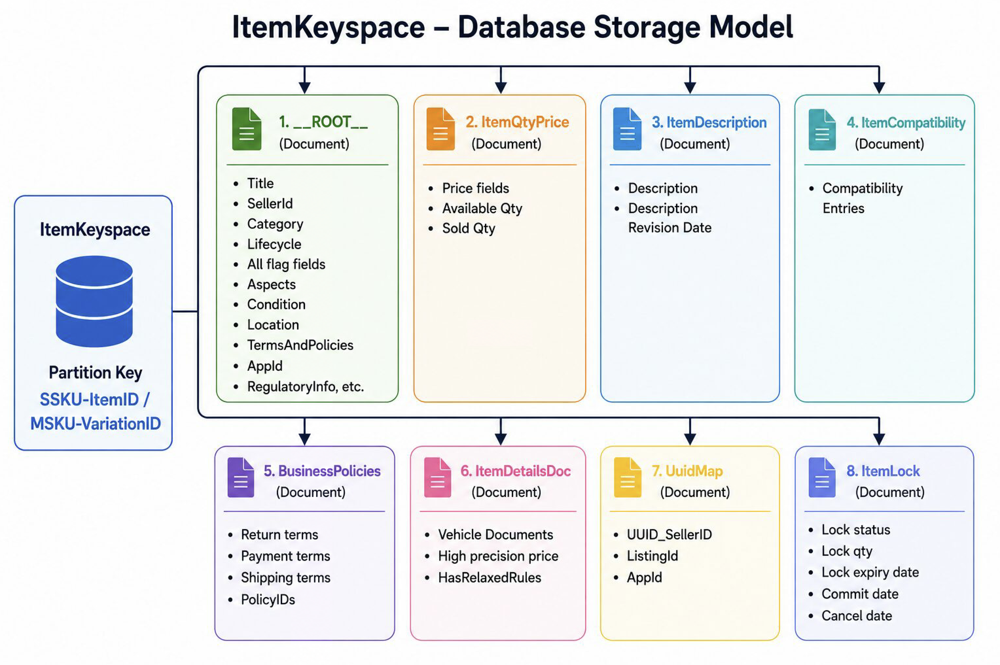

# Listing NuData Design

Source wiki: <https://wiki.corp.ebay.com/spaces/LS/pages/2269021214/Listing+NuData+Design>

## NuData Keyspaces

| Data | Keyspace |
| --- | --- |
| Live Listing Data | `ItemKeyspace`, `ItemGroupKeyspace` |
| Draft Data | `ListingDraft`, `UserListingDraft` |
| Revision History Data | `ListingRevisionKeyspace` |
| Archive Listing Data | `ItemKeyspaceArchive`, `ItemGroupKeyspaceArchive` |

## Listing Keyspace Data Storage Model

## Relational Data Flow Diagram: SSKU vs MSKU in NuData

The following diagram illustrates how data is organized and stored for Single SKU (SSKU) vs Multi-SKU (MSKU) listings in NuData, across `ItemKeyspace` and `ItemGroupKeyspace`. Data is sourced from the `crlstngsv` (Core Listing Service) codebase.

## 1. SSKU (Single SKU) Listing - ItemKeyspace Only

A Single SKU listing has one item stored entirely within `ItemKeyspace`, keyed by `itemId`. No group is created. The `isVariation` flag is false or absent.

`ItemKeyspace` | Primary Key = `itemId` | `isVariation = false / null`

### `__ROOT__` Document (Core Item Metadata)

#### Identity and Listing Data

- `PK = itemId`
- `sellerId`
- `title`
- `category`
- `conditionId`, `conditionDescription`
- `format` (`FixedPrice` / `Auction`)
- `lotSize`, `lotId`
- `sellerItemKey` (seller's SKU)
- `aspects` (item specifics)
- `images`
- `lifecycle` (`startDate`, `endDate`, `duration`)
- `marketplaceListedOn`
- `tradingScope`
- `inventoryTrackingMethod`

#### Item Metadata

- `isVariation = false`
- `creationDate`, `lastModifiedDate`
- `draftId`, `uuid`, `epid`
- `manageByInventory`
- `coreListingDataVersion`
- `regulatoryInfo`, `customPolicies`
- `extendedProducerResponsibility`

### SSKU Child Documents

| Document | Fields |
| --- | --- |
| `ItemDescription` | `description`, `compressedDescription`, `descriptionRevisionDate` |
| `ItemQtyPrice` | `availableQuantity`, `price` (value + currency), `quantitySold`, `minimumRemnantSet` |
| `FulfillmentTerms` | `shippingOptions`, `shippingTerms`, `packageSpec`, `weight`, `overrideShippingOptions` |
| `BusinessPolicies` | `payment policy ID`, `fulfillment policy ID`, `return policy ID`, `businessPolicyIdentifiers` |
| `ReturnTerms` / `Tax` / Others | `returnTerms` (domestic/intl), `tax` (VAT, etc.), `buyerRestrictions`, `lifecycle`, `paymentTerms` |

## 2. MSKU (Multi-SKU / Variation) Listing - ItemGroupKeyspace + ItemKeyspace

A Multi-SKU listing stores group-level shared data in `ItemGroupKeyspace` and per-variation data in `ItemKeyspace`. Each variation item has `isVariation = true`. The group document references all variation item IDs via `itemIds[]`.

### `ItemGroupKeyspace` | PK = `groupId`

#### `__ROOT__` Document (Group Root)

Identity and metadata:

- `PK = groupId`
- `groupOwner` (`sellerId`)
- `groupTitle` (shared title)
- `groupType`
- `sellerGroupKey` (group SKU)
- `groupVersion`
- `groupDraftId`
- `createdDate`, `lastModifiedDate`
- `adminEndedDate`
- `httpsCompliant`

Variation linking:

- `itemIds[] -> [itemId1, itemId2, ...]`
- `itemsVaryBy` (e.g., Color, Size)
- `imagesVaryBy` (trait for images)
- `images` (group product images)
- `compatibilities`
- `globalIdentifiers` (UPC, EAN)
- `managedFulfillmentSupported`

### MSKU Group Child Documents

| Document | Fields |
| --- | --- |
| `GroupDescription` | `groupDescription` (HTML), `compressedGroupDescription`, `groupDescriptionRevisionDate`; shared description for all variations |
| `GroupBusinessPolicies` | Payment policy ID, fulfillment policy ID, return policy ID; shared policies across variations |
| `TraitImages` / `ImagesVaryBy` | Images mapped per variation trait value (e.g., `Color=Red -> image URL`); `imagesVaryBy -> trait name driving image variation` |

### Group to Variation Item Relationship

`itemIds[]` links the group document to variation items in `ItemKeyspace`.

### `ItemKeyspace` | PK = `itemId` | `isVariation = true`

#### `__ROOT__` - Variation Item (repeated N times, one per SKU)

Identity:

- `PK = itemId` (unique per variation)
- `isVariation = true`
- `sellerId`
- `title`
- `category`
- `conditionId`
- `format`
- `sellerItemKey` (variation SKU)

Variation-specific data:

- `aspects` (e.g., `Color=Red`, `Size=M`)
- `images` (variation-level images)
- `lifecycle` (start/end dates)
- `creationDate`, `lastModifiedDate`
- `uuid`, `epid`
- `draftId`
- `inventoryTrackingMethod`

### MSKU Variation Child Documents

| Document | Fields |
| --- | --- |
| `ItemQtyPrice` (per variation) | `availableQuantity` (per variation), `price` (per variation), `quantitySold`, `minimumRemnantSet` |
| `ItemDescription` (variation) | `description` (variation-specific), `compressedDescription`, `descriptionRevisionDate` |

!!! note
    Shared data (description, business policies, group title) is stored in `ItemGroupKeyspace`, not duplicated per variation item.

## 3. Key Differences: SSKU vs MSKU Storage Summary

| Attribute / Field | SSKU (Single SKU) | MSKU (Multi-SKU / Variation) |
| --- | --- | --- |
| Keyspaces Used | `ItemKeyspace` only | `ItemGroupKeyspace` + `ItemKeyspace` (one row per variation) |
| Primary Key | `itemId` (`ItemKeyspace` PK) | `groupId` (`ItemGroupKeyspace` PK) + `itemId` per variation (`ItemKeyspace` PK) |
| `isVariation` flag | `false / null` | `true` on each variation item in `ItemKeyspace` |
| Number of `ItemKeyspace` records | 1 (for the single item) | N (one per variation, all with `isVariation=true`) |
| Number of `ItemGroupKeyspace` records | None | 1 (one group document linking all N variations) |
| Title | Per item: `ItemKeyspace.__ROOT__.title` | Shared: `ItemGroupKeyspace.__ROOT__.groupTitle` |
| Description | Per item: `ItemKeyspace.ItemDescription` | Shared: `ItemGroupKeyspace.GroupDescription` |
| Price and Quantity | Per item: `ItemKeyspace.ItemQtyPrice` | Per variation: `ItemKeyspace.ItemQtyPrice` (one per `itemId`) |
| Aspects / Variation Traits | `ItemKeyspace.__ROOT__.aspects` (item specifics) | `ItemKeyspace.__ROOT__.aspects` (specific trait values per variation) + `ItemGroupKeyspace.itemsVaryBy` (trait names) |
| Business Policies | `ItemKeyspace.BusinessPolicies` (per item) | `ItemGroupKeyspace.GroupBusinessPolicies` (shared across all variations) |
| Images | `ItemKeyspace.__ROOT__.images` | Group-level: `ItemGroupKeyspace.__ROOT__.images` + `TraitImages`; variation-level: `ItemKeyspace.__ROOT__.images` |
| Seller Item Key (SKU) | `ItemKeyspace.__ROOT__.sellerItemKey` | `ItemGroupKeyspace.__ROOT__.sellerGroupKey` (group) + `ItemKeyspace.__ROOT__.sellerItemKey` (per variation) |
| Item Linking | No group linkage | `ItemGroupKeyspace.__ROOT__.itemIds[] -> list of variation itemIds` |
| Seller ID | `ItemKeyspace.__ROOT__.sellerId` | `ItemGroupKeyspace.__ROOT__.groupOwner` (`sellerId`) + `ItemKeyspace.__ROOT__.sellerId` per variation |
| Global Identifiers (UPC/EAN) | `ItemKeyspace.__ROOT__.gblIdentifiers` | `ItemGroupKeyspace.__ROOT__.globalIdentifiers` (shared at group level) |
